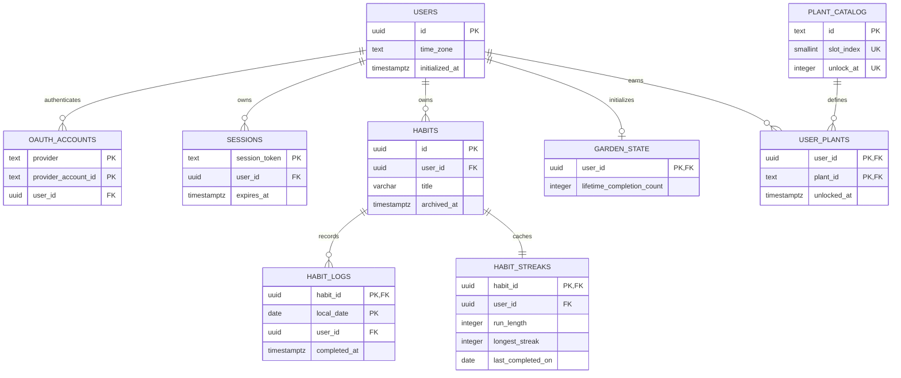

# Phase 0.2 — Data and domain design

Status: proposal awaiting Phase 0 approval. Date: 2026-10-21, Asia/Kuala_Lumpur. This document specifies behavior and schema; it contains no executable application implementation.

## Rules and MVP boundaries

1. A habit is daily and owned by exactly one user. Title length is 1–80 characters after trimming. A user may have at most **10 active habits**; creation checks the count under the same user lock as other mutations. Archive frees active capacity. There is no scheduling or title editing in MVP.
2. A completion means one successful insert for one owned habit on the authoritative current local calendar date. `(habit_id, local_date)` is unique. Same-day duplicate requests return `already_completed` and have no additional business effect.
3. The request contains `habitId` and `expectedLocalDate` from the last server-rendered dashboard. The latter is a precondition, never authority to choose a completion date. The server takes the authenticated user's row lock, obtains one database clock instant **after** lock acquisition in a separate statement, and converts it through the stored timezone. A stale expected date returns `DAY_ROLLED_OVER` and inserts nothing. Refresh and a new explicit submit are required.
4. A user explicitly confirms an IANA timezone at first-run onboarding. It is immutable thereafter. Browser detection is a suggestion only. No arbitrary numeric offset or POSIX zone expression is accepted. The application and PostgreSQL must both recognize the identifier; rejection is safe if their timezone catalogs disagree.
5. No backfill, undo, reactivation, hard habit deletion, or account deletion UI exists in MVP. Archive hides the habit from today's list and blocks new completions. Logs, streak history, lifetime completion total, and earned plants remain. Same-day replay of an already-completed habit may still return `already_completed` after archival.
6. Each new accepted log adds one lifetime completion. All owned plants grow from this lifetime total. Missed days reset an effective streak but never shrink the garden, remove a plant, or subtract a reward.
7. The four catalog plants have deterministic fixed slots 0–3 and thresholds 0, 5, 15, and 30. Starter plant unlocks at onboarding. There is no garden placement editor, random reward, timer, cron, inventory, or independently stored growth value.

These boundaries and the 10-active-habit cap are proposed sensible defaults, awaiting approval with Phase 0. The user requirements establish the overall product, daily goals, streaks, and plants, not these exact numerical thresholds.

## Streak and growth semantics

`run_length` stores the run ending on `last_completed_on`; it is not always the current streak displayed today.

| Event/read | Result |
|---|---|
| First accepted completion | Run 1, best 1. |
| Completion on the calendar day after the last completion | Run +1; best becomes maximum of previous best and new run. |
| Completion after one or more fully missed dates | New run 1; preserve best. |
| Completion on the same date | Duplicate, no changes. |
| Stored last completion later than authoritative date | Invariant error; no mutation or silent correction. |
| Read today; last completion today or yesterday | Display stored run. Yesterday's run stays alive until today is missed. |
| Read today; last completion older than yesterday or absent | Display current 0; preserve stored best/history. |

Use calendar-date arithmetic, not elapsed 24-hour periods. Leap days, month/year boundaries, and DST days with 23 or 25 hours follow the user's civil dates. Day rollover is defined by the **post-lock** DB clock, so a request arriving before midnight but queued until after it receives the day-change error instead of an unintended next-day completion. A retry after a lost response that crosses midnight also receives the stale-date error. Idempotence guarantees at most one business effect per habit/date, not replay of an old HTTP response across days.

For each owned plant, `growthPoints = lifetimeCompletionCount - plant.unlockAt`. This is nonnegative for an eligible owned plant. Every existing plant gains a point on a new accepted completion; a newly unlocked plant starts at zero on the threshold-reaching completion.

| Plant ID / fixed slot | Unlock total | Initial points |
|---|---:|---:|
| `clover` / 0 | 0 | 0 |
| `daisy` / 1 | 5 | 0 |
| `sunflower` / 2 | 15 | 0 |
| `cherry` / 3 | 30 | 0 |

| Growth points | Stage | Stage index |
|---:|---|---:|
| 0–2 | Sprout | 0 |
| 3–6 | Seedling | 1 |
| 7–13 | Growing | 2 |
| 14+ | Mature | 3 |

The total is a monotonic integer. A mature plant stays mature. Example: total 5 unlocks daisy with 0 points while clover has 5 points and is a seedling. Total 15 unlocks sunflower at 0; daisy has 10 and clover has 15. Garden stage and slot come from catalog+total at read time; they are not stored in another cache.

## Entity relationships

An uninitialized Auth.js user may have no garden; every initialized user must have exactly one. Every habit has exactly one streak row, inserted in its creation transaction. Mermaid cardinality describes the intended invariant; the transaction and integration tests also verify it.

## Nine-table schema contract

UUID IDs are generated in the application using the standard runtime cryptographic UUID API. For adapter-created users, declare the Drizzle runtime UUID default so the adapter recognizes the ID column as having a default (`hasDefault`); a bare nondefault UUID column is insufficient. `users.created_at` has a database current-timestamp insert default because stock adapter creation supplies profile fields only. Verify both defaults through a real adapter create-user integration test. `date` means a civil calendar date; `timestamptz` means an instant. All fields below are NOT NULL unless marked nullable. Do not store dates as ambiguous server-local strings or serialize `date` through a JavaScript timestamp.

| Table | Fields, keys and constraints |
|---|---|
| `users` | `id uuid PK` with adapter-recognized runtime cryptographic UUID default; `name text nullable`; `email text nullable UNIQUE`; `email_verified_at timestamptz nullable`; `image text nullable`; `time_zone text nullable`; `initialized_at timestamptz nullable`; `created_at timestamptz` with DB insert-time default. Timezone and initialized timestamp must either both be null or both be nonnull. A trigger rejects changing or clearing an initialized timezone. Email is optional and does not authorize account linking. |
| `oauth_accounts` | `user_id uuid FK users`; `type text` constrained to `oauth`; `provider text` constrained to `github`; `provider_account_id text`; PK `(provider, provider_account_id)`. Standard nullable Auth.js token fields: `refresh_token text`, `access_token text`, `expires_at integer`, `token_type text`, `scope text`, `id_token text`, `session_state text`. Keep adapter property names compatible while mapping physical snake_case columns. |
| `sessions` | `session_token text PK`; `user_id uuid FK users`; `expires_at timestamptz`. Tokens are private credentials, never returned in app DTOs or logs. |
| `habits` | `id uuid PK`; `user_id uuid FK users`; `title varchar(80)` with trimmed, nonblank, length 1–80 checks; `created_at`, `updated_at timestamptz`; `archived_at timestamptz nullable`, constrained to be no earlier than creation. `UNIQUE(user_id, id)` supports ownership foreign keys. Archive timestamp is immutable once set. |
| `habit_logs` | `habit_id uuid`; `user_id uuid`; `local_date date`; `completed_at timestamptz`; PK `(habit_id, local_date)`; composite FK `(user_id, habit_id)` → `habits(user_id, id)`. No separate log ID. Logs are immutable; no runtime UPDATE/DELETE privileges. |
| `habit_streaks` | `habit_id uuid PK`; `user_id uuid`; `run_length integer DEFAULT 0`; `longest_streak integer DEFAULT 0`; `last_completed_on date nullable`; composite ownership FK to habits. Counts ≥0, best ≥ run; null date iff both counts are 0; a nonnull date requires run ≥1. |
| `plant_catalog` | `id text PK`; `slot_index smallint UNIQUE`; `unlock_at integer UNIQUE`. Checks restrict the four exact ID/slot/threshold combinations above. Exactly four initial rows are installed by migration. No runtime write privileges. |
| `user_plants` | `user_id uuid FK users`; `plant_id text FK plant_catalog`; `unlocked_at timestamptz`; PK `(user_id, plant_id)`. No duplicated stage, growth points, or slot column. Append-only rewards; no runtime UPDATE/DELETE privileges. |
| `garden_state` | `user_id uuid PK/FK users`; `lifetime_completion_count integer DEFAULT 0 CHECK ≥0`; `updated_at timestamptz`. One row per initialized user. Counter must equal retained log count; this cross-table invariant is maintained by transactions and verified by tests, not a cross-table CHECK. |

Use `ON DELETE RESTRICT` for domain relationships. Adapter-compatible cascade may apply to accounts/sessions; domain references still prevent deletion of initialized users. The runtime role has no domain DELETE privilege even for a habit without logs. A privileged migration role is separate. Runtime may read catalog and its own domain records through scoped repositories; no browser has direct SQL credentials. Runtime privilege design must account for Auth.js account/session insert/update/delete without giving domain tables unnecessary permissions.

PostgreSQL CHECK constraints cannot safely enforce other rows' or tables' state. Active habit cap, IANA zone recognition, initialized-user garden existence, catalog completeness, unlock eligibility, and counter/streak agreement are application transaction invariants, reinforced by fixed catalog migration/privileges and integration tests. Do not label them declarative DB guarantees when they are not.

## Indexes and query shapes

| Index | Purpose |
|---|---|
| Auth PKs and `users(email)` UNIQUE | Provider identity, session token and adapter email lookup. PostgreSQL allows multiple null emails. |
| `oauth_accounts(user_id)`, `sessions(user_id)` | Auth user lookup and account/session cleanup. Add expiry index only when actual cleanup queries justify it. |
| `habits(user_id, id)` UNIQUE | Composite ownership FK and scoped lookup. |
| Partial `habits(user_id, created_at, id)` where not archived | Active dashboard list and count/cap. |
| `habit_logs(habit_id, local_date)` PK | Same-day uniqueness and one habit's date history. |
| `habit_logs(user_id, local_date DESC, habit_id)` | Scoped date/history aggregation and consistency checks. |
| `habit_streaks(habit_id)` PK | One cache row per habit. |
| Catalog slot/threshold UNIQUE; `user_plants(user_id, plant_id)` PK; `garden_state(user_id)` PK | Deterministic slots, unique rewards, and one total. |

Dashboard queries must constrain user ownership and return one consistent snapshot. Derive one read-time `asOf` instant and local date from the DB clock plus stored timezone, and reuse that date for today's log filter, `projectCurrentStreak`, the displayed date, and the `expectedLocalDate` precondition. No browser, process-UTC, or fallback server-zone value substitutes for it. Use one SQL statement or an explicitly consistent read transaction for habits, today's logs, streaks, total, and plants; multiple unrelated READ COMMITTED queries can mix committed versions. Pagination is unnecessary for the 10-active-habit list; historical/admin repair reads must be bounded. There is no general public history/export endpoint in MVP.

## Atomic write protocol

All domain writers—onboarding, create, archive, complete—acquire the user row lock first, then subordinate rows in a fixed order. Same-user work serializes; different users remain independent. Do not call OAuth, Vercel, network services, or wait for user input inside a transaction.

Completion runs at READ COMMITTED:

1. Resolve an unexpired database session and its user ID server-side. Validate command shape; begin transaction.
2. Lock that user row; reject uninitialized users. Fetch the habit using **both** habit ID and owner ID. Missing and foreign-owned resources both return not found.
3. In a **separate statement after the lock**, capture `clock_timestamp()` once. Derive the authoritative local date using the stored timezone. Do not use transaction-start `now()` or a clock expression in the locking SELECT.
4. Compare validated `expectedLocalDate`. On mismatch return `DAY_ROLLED_OVER` (HTTP 409 where applicable), no writes.
5. If today's log exists, return `already_completed` with a consistent projection and no writes. Check this before archive rejection so safe same-day replays remain idempotent.
6. Reject an archived habit with `HABIT_ARCHIVED` if there is no existing log. Insert the log; only an insertion confirmed by `RETURNING` may advance rewards. PK uniqueness is defense in depth.
7. Advance streak cache using the accepted local date. Increment garden total once. Insert every newly eligible plant using the same captured instant; reward PK prevents duplication.
8. Return the resulting consistent projection and commit. Any failed statement rolls back log, streak, total, and unlock together. Do not catch an error and continue a partial transaction.

Onboarding uses the same lock, validates the zone against both supported IANA identifiers and DB recognition, and sets zone/initialized time plus count-0 garden and starter plant atomically. A same-zone retry returns existing state; a different-zone retry returns `TIME_ZONE_FIXED`. An initialized user with missing garden state is an invariant failure requiring diagnosis, not permission to reset its total to zero.

Creation enforces active count, creates a habit and a zero streak row atomically. Archive locks user then owned habit, sets `archived_at` once, and returns success on repeat. With an archive/completion race, archive-first prevents a new log; completion-first preserves the reward and later archives normally. No writer bypasses the common user lock.

## Pure domain specifications

The domain layer receives validated date values, previous state, and catalog data. It has no clock, DB, session, environment, framework, or network imports. Its contracts are:

- `guardExpectedDate(expected, authoritative)` returns success or `DAY_ROLLED_OVER`.
- `advanceStreak(previous, acceptedDate)` returns a new streak or a duplicate/date-order error.
- `projectCurrentStreak(streak, asOfDate)` returns the display streak without mutating stored history.
- `advanceGarden(previousTotal, catalog)` returns next total and newly eligible plant IDs.
- `projectPlant(total, catalogPlant)` returns growth points and one of the four named stages.

Use a validated canonical `YYYY-MM-DD` date value and calendar arithmetic. Timezone conversion stays in the service/database layer. Validate raw titles, UUIDs, IANA zone IDs, and dates at the boundary before calling these functions.

## Migration and fixture strategy

Choose **Drizzle**, rather than Prisma, for explicit typed SQL, transparent PostgreSQL constraints/partial indexes, and reviewable migrations with the `pg` driver. Prisma would also work but adds a separate generated client and offers no MVP advantage here. This is a proposal until Phase 0 approval.

Commit sequential generated-and-reviewed SQL and Drizzle metadata. The first migration creates the nine tables, constraints, indexes, immutable-field guards/permissions, and four catalog rows. Future catalog threshold changes are a product/data migration decision; a seed must never silently upsert different thresholds. Use the same migrations from an empty DB in development, integration tests, and deployment. Test applying them twice: the runner journal prevents reapplication and state remains unchanged.

A single production migration runner obtains a PostgreSQL advisory lock on a dedicated direct `pg.Client` session and holds it through the migration sequence. Session locks must not pass through transaction pooling. Release details and stale-main checks are in `03-cicd-plan.md`. Only reviewed additive/backward-compatible migrations run automatically. No production seed, reset, destructive migration, broad deletion, or automatic down migration is authorized. Future destructive work requires separate review/approval and backup/recovery design. Rollbacks keep the forward schema and restore compatible app code.

Local development seed is explicit, deterministic, idempotent, and guarded to an explicitly named loopback development DB. It creates two fictional users and reproducible habit/log/streak/garden fixtures without deleting or overwriting existing data. If a fixture key exists with unexpected data, stop and report the conflict. It never runs in production or as part of build/deploy. Seeded users do not automatically become real GitHub identities; local real login requires OAuth credentials, while automated tests create isolated real adapter sessions in test code only. Tests use a separate disposable loopback DB and may reset only that verified exact target.

Streak and total caches can later be rebuilt from immutable logs under the same user lock. That repair is an explicit audited maintenance task, not a hidden read-path repair or production startup behavior. Future timezone editing must preserve past civil dates and requires a new product/migration design.

## Required verification scenarios

- Streak first/consecutive/missed/duplicate/read-expiry cases; leap-day and month/year boundaries; America/New_York spring/fall DST and Asia/Kuala_Lumpur dates; immutable timezone confirmation.
- Stage boundaries 0, 2, 3, 6, 7, 13, 14; unlock totals 4→5, 14→15, 29→30; zero points on unlock; mature cap.
- Concurrent same-habit/date requests produce exactly one log and increment; concurrent different habits add two; different users do not block each other unnecessarily.
- A queued request across midnight uses the post-lock clock and rejects its stale expected date; a lost-response retry next day cannot create an accidental extra log.
- Inject failure before reward commit: log, streak, total, and plant unlock all roll back.
- Archive-first/complete-first and same-day duplicate-after-archive behavior; cap enforcement under concurrent create; archive frees capacity.
- Foreign user returns not found with no mutation; composite FK rejects mismatched owner; no/expired session cannot mutate; runtime cannot delete histories/habits/rewards or alter timezone/catalog.
- Concurrent onboarding creates exactly one garden/starter; repeat same zone succeeds; different zone fails; missing initialized state errors.
- Recomputed counters/streaks from retained logs equal caches; dashboard reads a coherent snapshot; seed and reset guards reject production/non-loopback/ambiguous targets.

These are acceptance specifications. No SQL, migration, seed, unit/integration test, or DB engine has run for this app during Phase 0.

## Official references inspected

- [PostgreSQL constraints and cross-table CHECK limitations](https://www.postgresql.org/docs/current/ddl-constraints.html).
- [PostgreSQL row locks](https://www.postgresql.org/docs/current/explicit-locking.html), [transaction snapshots](https://www.postgresql.org/docs/current/transaction-iso.html), and [clock functions](https://www.postgresql.org/docs/current/functions-datetime.html).
- [Auth.js Drizzle adapter/custom tables](https://authjs.dev/getting-started/adapters/drizzle) and [official PostgreSQL adapter shape](https://github.com/nextauthjs/next-auth/blob/main/packages/adapter-drizzle/src/lib/pg.ts).
- [Drizzle PostgreSQL driver](https://orm.drizzle.team/docs/get-started-postgresql).
